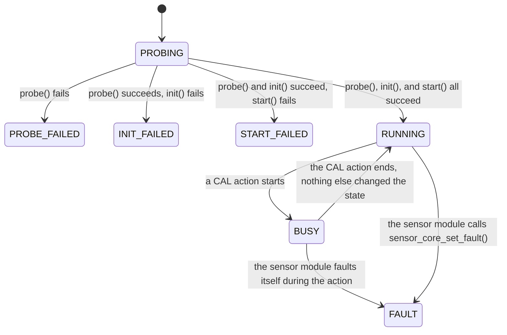
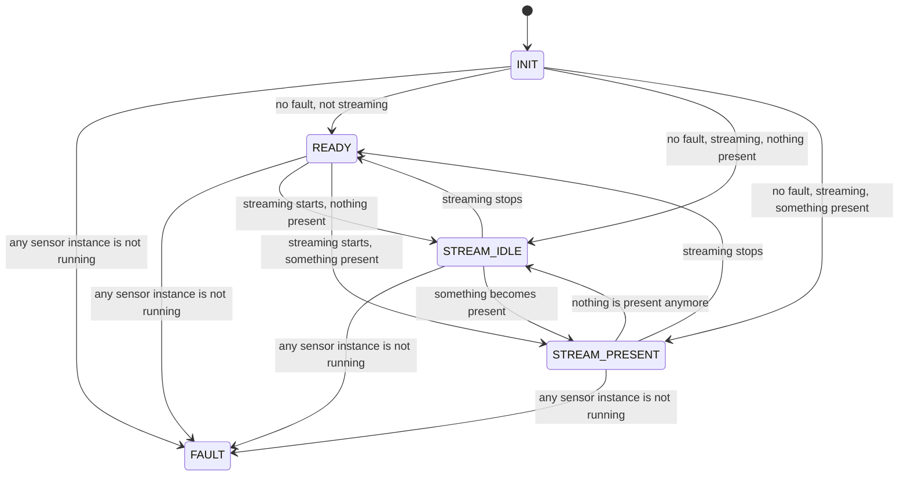
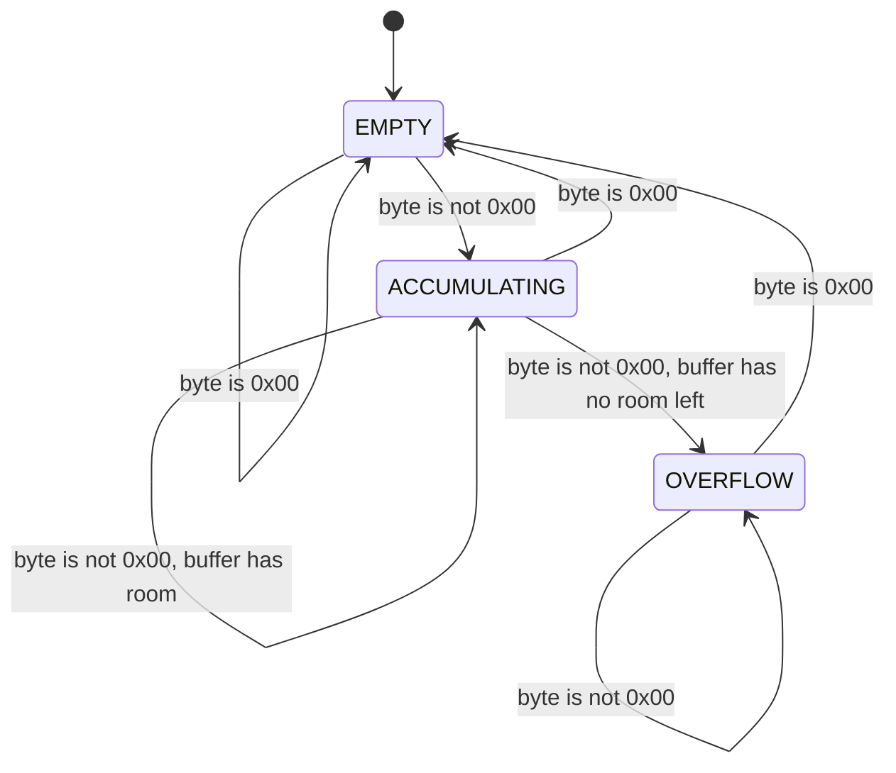

# State Machines

This document lists every state machine in the firmware, with a diagram for each. See
`docs/00-overview.md` for term definitions.

## Sensor instance lifecycle

`components/sensor_core` tracks each sensor instance's state. The state controls three things:
whether a channel's `get()` call reaches the sensor module, whether `SCFG` and `CAL` accept a
command for this instance, and whether the poll task calls `poll()` on it.

| State | Reported on `SENS` as | Meaning |
|---|---|---|
| `PROBING` | Never seen on the wire; this state lasts only until `probe()` returns. | The instance exists, but no lifecycle step has run yet. |
| `PROBE_FAILED` | `fault` | `probe()` found no chip, or the wrong chip. |
| `INIT_FAILED` | `init_failed` | The chip was found, but one-time setup failed. |
| `START_FAILED` | `start_failed` | Setup succeeded, but the chip did not start sampling. |
| `RUNNING` | `ok` | Normal operation. |
| `BUSY` | `busy` | A `CAL` action owns the chip right now. |
| `FAULT` | `fault` | The sensor module gave up trusting its own data. |

`PROBE_FAILED`, `INIT_FAILED`, `START_FAILED`, and `FAULT` are terminal states. This version
does not retry or re-probe an instance on its own. Each needs a device restart (`RST`) to
leave.

A channel's `get()` call reaches the sensor module only from `RUNNING` or `BUSY`. From every
other state, it returns a CBOR `null` value with no call into the sensor module at all. This
holds even for `PROBING`, so a host can call `GET` the instant a channel appears on the wire,
before `probe()` has run, with no risk of reading an unset value.

`SCFG` and `CAL` both require exactly `RUNNING`. `BUSY` is rejected too, so a configuration
write cannot run while a calibration action owns the same instance's chip.

`PROBING` is the zero value of this state's underlying type, on purpose.
`sensor_core_register()` reserves a new instance's array slot before filling in any of its
fields. The poll task, already running on its own task, can see that slot during the brief
window before its state is set explicitly. Zero-initialized memory already means "do not poll
this instance, and do not call its `get()`", which is exactly what `PROBING` means.

## Status LED

`components/status_led` tracks which status color to show, while the device's `LED_MODE`
configuration key is `STATUS`. `main/devices/atoms3_lite/app_main.c`'s `led_monitor_task`
recomputes this state every 200 milliseconds, from `sensor_core_any_fault()` and from whether
the device is streaming. See `docs/10-led-status.md` for what each state looks like on the
light itself.

`FAULT` has no outgoing edge in this diagram. The sensor instance lifecycle above shows that a
fault state is terminal for the rest of that boot, so `sensor_core_any_fault()` cannot return to
false until the device restarts. A restart re-enters this state machine at `INIT`.

Two overlays sit on top of this state machine. Neither is a state of it:

| Overlay | Starts on | Effect | Ends on |
|---|---|---|---|
| One-shot flash | Any `GET` command | Shows white for 60 milliseconds, replacing the current color | 60 milliseconds elapse |
| `MANUAL` mode | `SET led0`, or `CFG LED_MODE MANUAL` | Shows a host-chosen color, replacing the state machine's color | `CFG LED_MODE STATUS` |

While `MANUAL` mode is active, this state machine keeps running underneath it. Switching back
to `STATUS` mode shows whatever color it has computed by then, with no jump and no delay.

## USB command frame receiver

`components/device_proto`'s `usb_cdc.c` collects bytes from the host into one buffer, `acc`,
until it sees a `0x00` byte: the frame delimiter. See `docs/06-cbor-encoding.md` for how a
frame's bytes are built, and `docs/12-flow-control-and-backpressure.md` for why this receiver
must never block.

The `0x00` byte that moves the receiver back to `EMPTY` also decides what happens to the bytes
already stored:

| State when the `0x00` arrives | What happens |
|---|---|
| `EMPTY` | Ignored. Not counted as a frame or as an error. |
| `ACCUMULATING` | Decoded. A successful decode goes to the command dispatcher. A failed decode counts as a Cyclic Redundancy Check (CRC) error. |
| `OVERFLOW` | Counted as a frame and as an error. The bytes that fit are not decoded. |

The receiver holds up to 320 bytes before the delimiter. The logic is in `rx_accum.c`, which the
host unit tests in `test/host/test_rx_accum.c` run.

The receiver drains the host's bytes in batches of 64, then yields its task, rather than running
until the host stops sending. This keeps a continuous flood of bytes from one connection from
starving every other task on the device. See `docs/12-flow-control-and-backpressure.md`.
